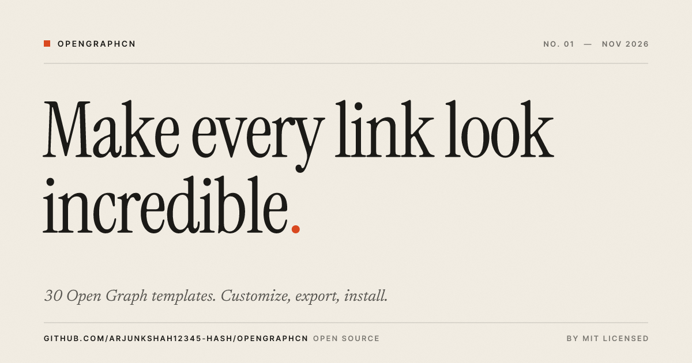
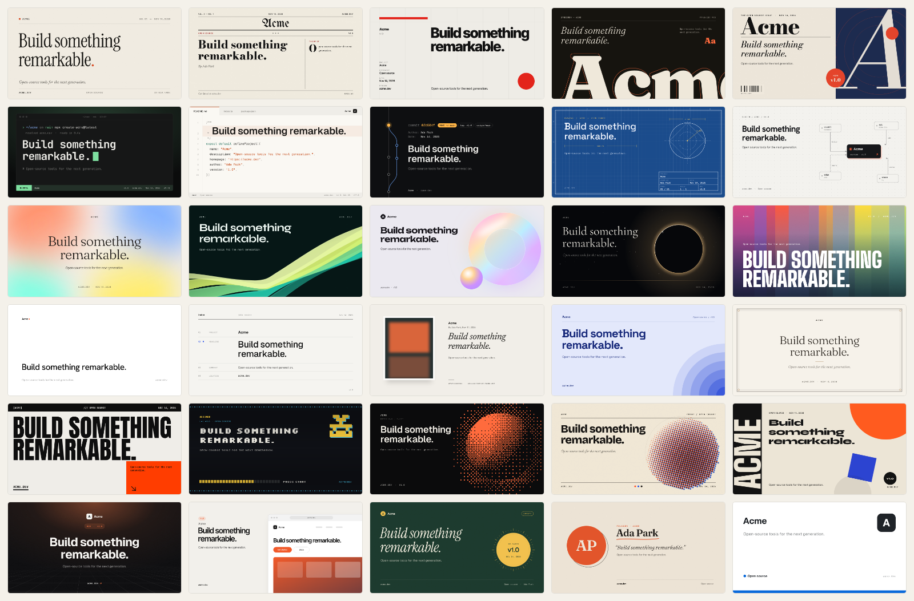

<p align="center">
  
</p>

<h1 align="center">opengraphcn</h1>

<p align="center"><b>Make every link look incredible.</b><br/>The open-source social image studio for developers — 30 Open Graph templates you can customize, export, and install.</p>

<p align="center">
  <a href="https://arjunkshah12345-hash.github.io/opengraphcn/">Website</a> ·
  <a href="https://arjunkshah12345-hash.github.io/opengraphcn/#/studio">Studio</a> ·
  <a href="https://arjunkshah12345-hash.github.io/opengraphcn/#/templates">Templates</a> ·
  <a href="https://arjunkshah12345-hash.github.io/opengraphcn/#/docs">Docs</a> ·
  <a href="https://arjunkshah12345-hash.github.io/opengraphcn/#/demo">30-second demo</a>
</p>

---



## What it is

- **30 templates in six collections** — Editorial, Developer, Abstract, Minimal, Experimental and Product. Each has its own composition, type pairing and layout rules, not a colour swap.
- **A Studio** — live 1200×630 canvas, template browser, content/style/brand controls, logo and screenshot uploads, undo/redo, local saves, share links and GitHub repository import.
- **Real exports** — PNG (1× and 2×), standalone SVG with embedded fonts, React source, a Next.js `opengraph-image.tsx`, and versioned JSON.
- **An installable registry** — every template is a small React file you add with the shadcn CLI. Installing one template doesn’t pull in the website.
- **Completely static** — runs on GitHub Pages. No backend, no accounts.

## Install a template

```bash
npx shadcn@latest add https://arjunkshah12345-hash.github.io/opengraphcn/r/monograph.json
```

```tsx
import { MonographImage } from '@/components/opengraphcn/templates/monograph'

export function Preview() {
  return <MonographImage content={{ name: 'Acme', headline: 'Build something remarkable.' }} theme={{ accent: '#e5481f' }} />
}
```

Swap `monograph` for any template id (see the [template reference](https://arjunkshah12345-hash.github.io/opengraphcn/#/docs/templates)). Files land in `components/opengraphcn/{core,templates}`; the only runtime dependency is React.

## Next.js Open Graph images

```bash
npx shadcn@latest add https://arjunkshah12345-hash.github.io/opengraphcn/r/monograph.json https://arjunkshah12345-hash.github.io/opengraphcn/r/server.json
```

```ts
// next.config.ts
export default { serverExternalPackages: ['@resvg/resvg-js', 'fontkit'] }
```

```tsx
// app/opengraph-image.tsx
import { monograph } from '@/components/opengraphcn/templates/monograph'
import { renderOgPng } from '@/components/opengraphcn/server/render'

export const runtime = 'nodejs'
export const size = { width: 1200, height: 630 }
export const contentType = 'image/png'

export default async function Image() {
  const png = await renderOgPng(monograph, { content: { name: 'Acme', headline: 'Build something remarkable.' } })
  return new Response(png, { headers: { 'Content-Type': 'image/png' } })
}
```

`next/og` (Satori) can’t draw SVG `<text>`, filters or patterns, so opengraphcn renders the same SVG as the Studio, outlines text with fontkit (TTFs fetched once from the Fontsource CDN) and rasterizes with resvg. This was verified with `next build` + `next start` on Next.js 16. Node runtime only.

## How rendering works

| Layer | What it does |
| --- | --- |
| `src/og/core/fonts.ts` | Generated: font manifest + advance widths for 53 OFL faces (`npm run metrics`). |
| `src/og/core/text.ts` | Deterministic wrapping and fitting — largest size that fits without breaking words, then an ellipsis. Same result in the browser, Node and RSC. |
| `src/og/core/primitives.tsx`, `kit.tsx` | `<Text>`, `<Frame>`, images, grain, layout blocks. Text renders as `<text>` or outlined glyph paths. |
| `src/og/templates/*.tsx` | One file per template: a pure function from props to `<svg>`. |
| `src/og/core/markup.ts` | Hook-free static serializer (no `react-dom/server`), safe in React Server Components. |
| `src/og/core/export.ts` | Browser export: SVG + embedded woff2 → canvas → PNG. |
| `src/og/server/render.tsx` | Server export: fontkit outlines + resvg. |

## Develop

```bash
npm install
npm run dev          # http://localhost:5173
npm test             # 184 render / serializer / codegen / server tests
npm run lint && npm run typecheck
npm run build        # registry + static site into dist/
npm run test:e2e     # production build: routes, PNG export for all 30 templates, SVG validity
```

`npm run test:e2e` and `scripts/record-demo.mjs` need a Playwright Chromium (`npx playwright install chromium-headless-shell`).

## Launch demo

Open [`/#/demo`](https://arjunkshah12345-hash.github.io/opengraphcn/#/demo) and press **Autoplay 30s** (or space): a default card → editorial in one click → eight different compositions → rename and recolor → a real PNG export → the repo and install command. Every step is a real state change. `node scripts/record-demo.mjs` records it to `test-output/demo/`.

## Deploy

GitHub Actions (`.github/workflows/deploy.yml`) lints, type-checks, tests, builds and publishes `dist/` to GitHub Pages on every push to `main`. For forks, set `BASE_PATH` and update `src/lib/site.ts`. See [docs/deployment.md](docs/deployment.md).

## Docs

- [Studio guide](docs/studio.md)
- [React installation](docs/react.md)
- [Next.js integration](docs/nextjs.md)
- [Exports](docs/exports.md)
- [Templates](docs/templates.md)
- [Deployment](docs/deployment.md)

## License

MIT — see [LICENSE](LICENSE). Fonts are licensed under the SIL Open Font License and distributed by [Fontsource](https://fontsource.org).
